# Meridian Deep — Build Previews (Phases 3–5)

Updated after each completed task so you can browse every new screenshot in one place.

## P4-5 — Live Map Wall & The Running Clock (`p4-5/`)

Backlit 40 × 7 m architectural transit map wall and the one living clock in the station (`src/metro/mapLayout.ts`, `src/world/metro/mapWall.ts`, **4 draw calls total**):
- **Backlit glass transit diagram (`2048×512`, drawn once):** deep obsidian architectural glass with slim brushed-stainless perimeter frame & glazing seams placed cleanly between stations, Meridian (ink blue), Vesper (jade), and Halcyon (oxblood) lines meeting symmetrically at `Meridian Deep`, aspect-corrected circular station nodes and unstretched Swiss typography across all 25 stations (including all 8 canonical names).
- **Live instanced train dots (≤ 4):** mapped from `timetable` `s` to exact UV (`2.84e-13 px` roundtrip accuracy, verified in `metro-map-test`), routing cleanly along the luminous `r = 1.44 m` interchange halo around the clock so stopped trains stay 100 % visible and pulse softly while dwelling.
- **2.4 m running white onyx clock:** backlit veined alabaster dial (no numerals), machined brushed-stainless bezel, 12 dark satin steel baton indices, hairline hour/minute hands, and a **continuous sweeping second hand** driven every displayed frame by `new Date()` (shares nothing with the frozen 6:47 brass clock upstairs).

- **Mapwall closeup t = 0 s (2.4 m backlit white onyx clock, Swiss station rings, 4 live train dots gliding & pulsing)** — 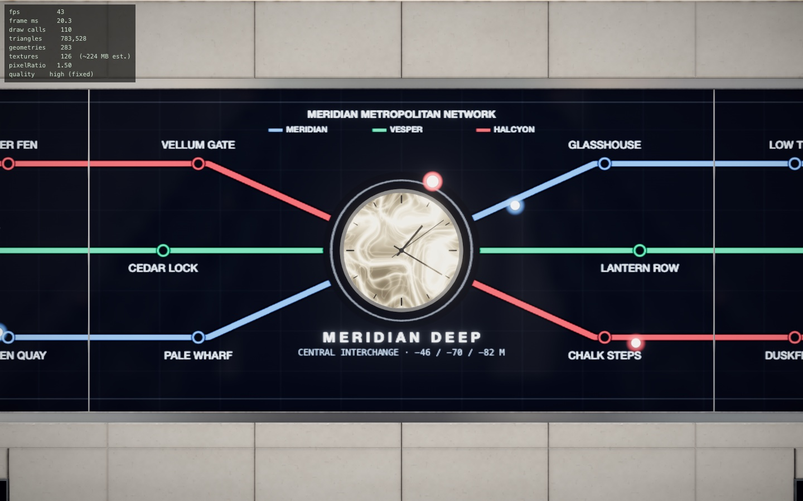
- **Mapwall closeup t = +3 s (3.1 s later — continuous sweeping second hand advanced + live train dots gliding onto the interchange ring)** — 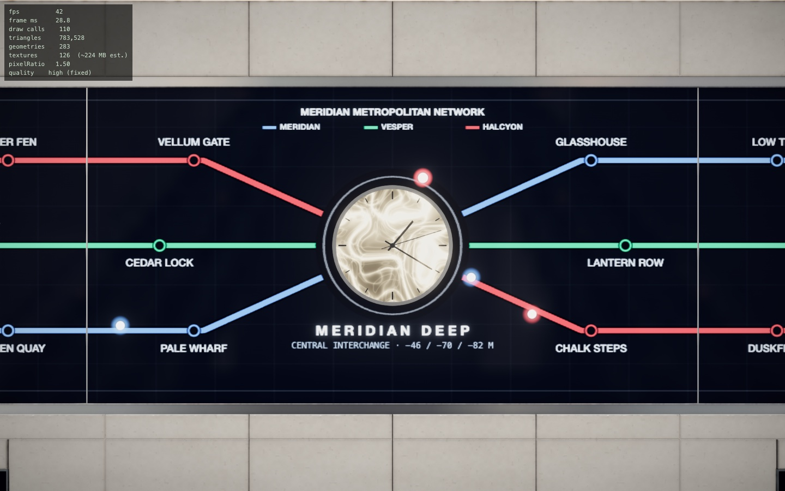
- **Mapwall (framed symmetrically from the Meridian island between the F4 escalators)** — 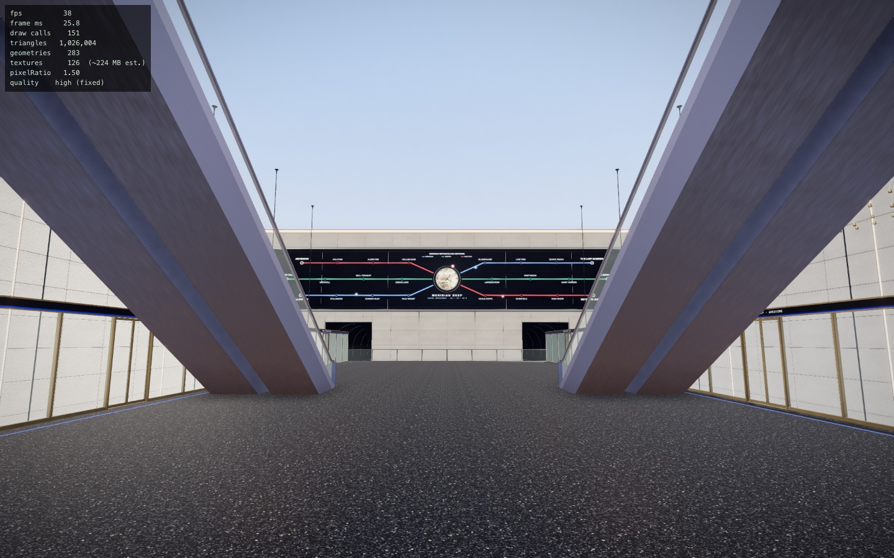
- **Skyride (descending F4 out of the sky rim flanked by golden droplet wings toward the live map wall & clock)** — 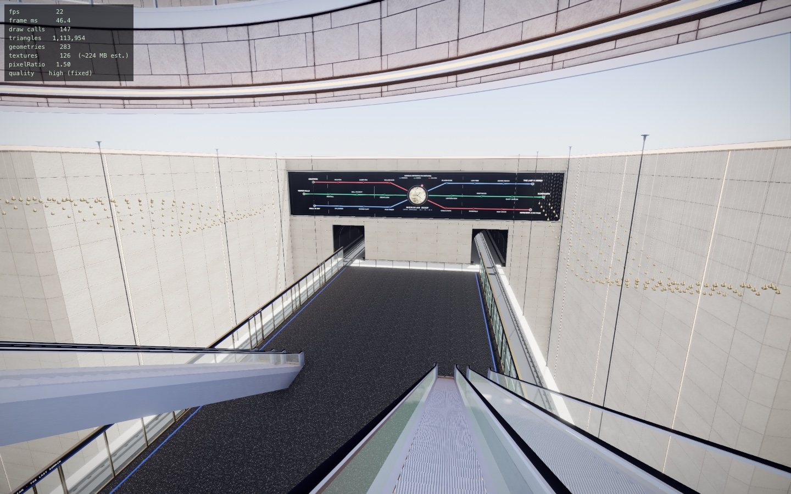
- **Floor (Crossing floor looking west toward twin lifts, water wall & sunlit droplet canopy above)** — 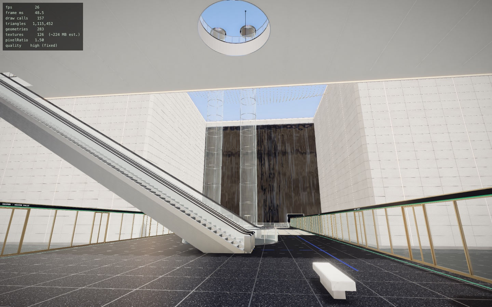

## P4-4 — Kinetic Droplet Ceiling (`p4-4/`)

Sculptural Changi "Kinetic Rain" canopy suspended beneath the buried noon sky in **2 draw calls** (`src/world/metro/droplets.ts`, Ruling 35):
- **2,314 polished champagne teardrops** (`140 tris` lathe each, `0.22 m` tall, env-mapped `kit.deep.champagne` clone, `noShadow`) on a `0.84 m` architectural lattice in `r ∈ [21, 38]` around `(0, 74)`, clipped `≥ 2 m` clear of all cavern walls & lift tubes and cleanly excluding the Meridian bridge (`|x| < 12.5`) and funicular corridor (`|z − 74| < 3, x > 16`).
- **2,314 gossamer hairline cables** in one merged distance-fading billboard ribbon mesh anchored at `SKY.y = −32`, sharing the exact GLSL elevation function so every cable stays locked to its moving droplet tip.
- **Vertex-shader choreography:** slow 45 s real-time sculptural cycle smoothly morphing `wave crest → 3-arm eclipse vortex → serene calm`, plus up to 4 simulation-time arrival pulses (`uPulse[4]`) rippling outward across the canopy from each arriving train's portal.

- **Droplets t = 0 s (new preset from Meridian north island — sweeping champagne canopy, sky behind & eclipse at upper-right edge)** — 
- **Droplets t = +1 s (1 s later — liquid wave crest rolling smoothly across the left foreground)** — 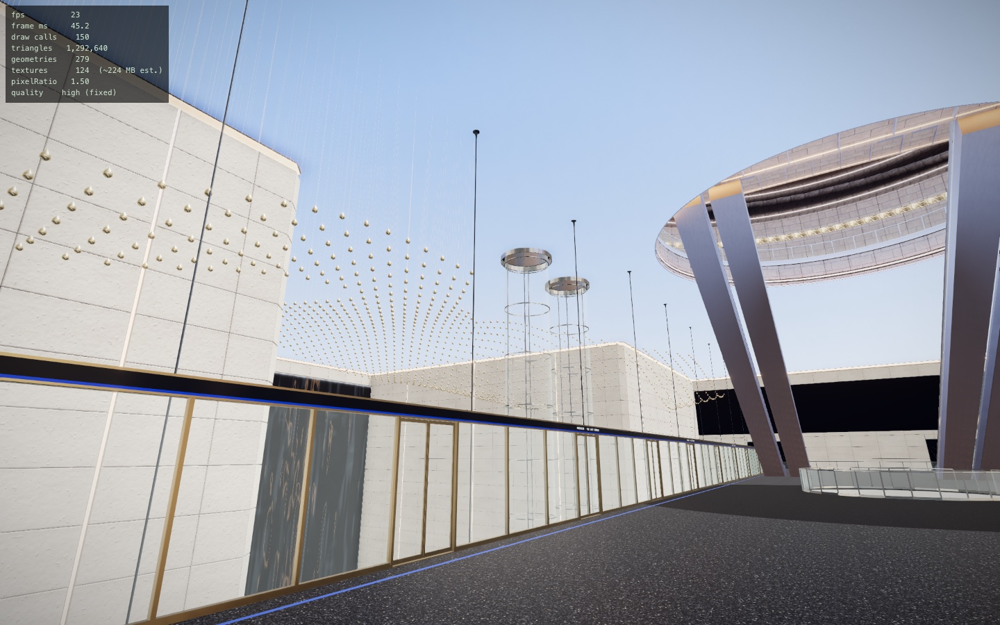
- **Droplets t = +2 s (2 s later — graceful heavy wave motion, zero jitter)** — 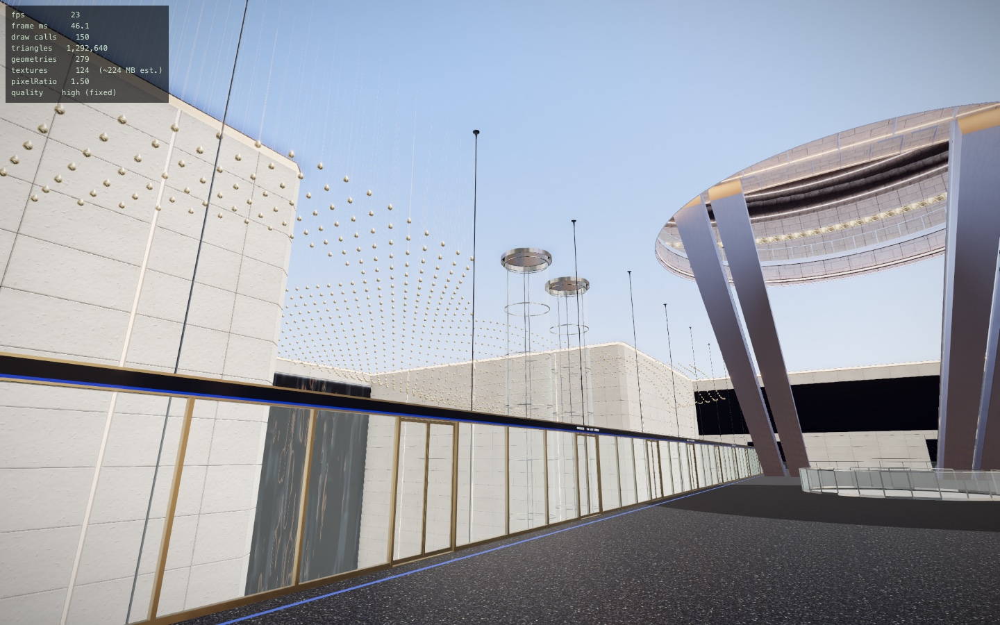
- **Skyhole (2,314 champagne teardrops framing the eclipse and parting cleanly around the funicular sky slot)** — 
- **Crossing (warm champagne canopy glinting in the upper-right sky pocket above the transept)** — 

## P4-3 — Synced Screen Doors, 12-Bore Light-Wave & Transom Displays (`p4-3/`)

Arrivals are now choreographed purely by light, motion, and quiet hairline typography (`0` extra draw calls):
- **Screen doors (`choreography.ts`, `psd.ts`, `metro.ts`):** exact analytic smoothstep inversion of `timetable`'s `doors01` (no timetable changes, Ruling 30) gives platform screen doors an exact **0.3 s opening lag** after the car doors start and an exact **0.3 s closing lead** before they finish. Every PSD pair checks geometric alignment against the stopped train's `doorOffsets()`; unaligned pairs or tracks with no stopped train stay strictly shut.
- **12-bore tunnel light-wave (`choreography.ts`, `portals.ts`):** travelling neutral-white crest (~4 segments wide) races down each train's `portalIn` bore and flares luminance-balanced line-colour mouth ribs **4.0 s before the nose emerges**, decaying cleanly over a 2 s afterglow; departing trains trail a fainter **40 % wake** into their `portalOut` bore. Multiple waves combine with `max` (zero flicker/overshoot).
- **Transom displays (`network.ts`, `psd.ts`):** hairline dot-matrix displays share the poetic station/destination list (`Vesper Falls`, `Halcyon`, `Hollow Bay`, `Ashgrove`, `Elsewhere`, `The Last Summer`, `Nowhere Junction`, `Meridian Deep`) and redraw the canvas **only** when state text changes (`ARRIVING` / `DOORS OPENING` / `DEPARTING`).

- **Portal sequence 1 — white light-wave racing down the dark horseshoe bore** — 
- **Portal sequence 2 — 3 ink-blue mouth ribs flaring 4 s before the nose arrives** — 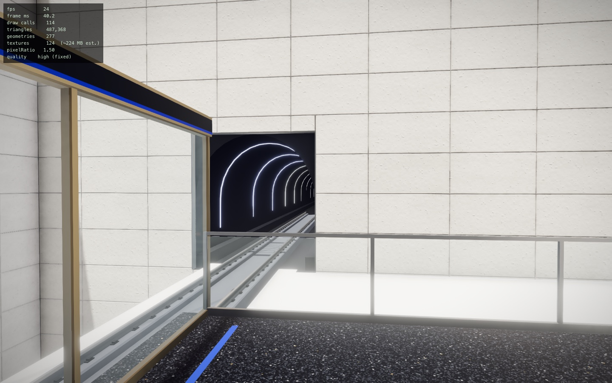
- **Portal sequence 3 — mirror Meridian train gliding cleanly out of the bore mouth** — 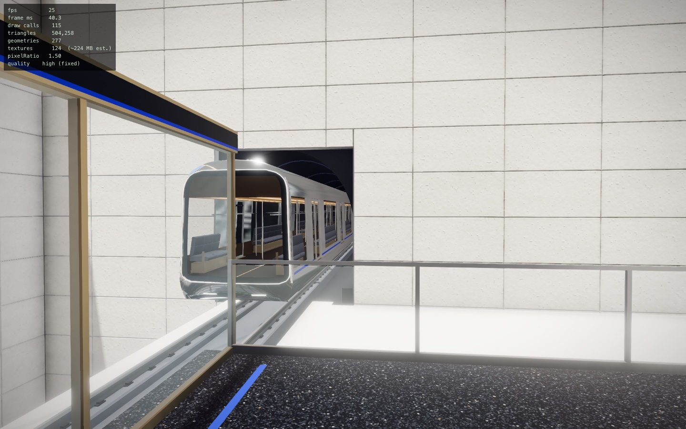
- **Vesper synced doors — PSDs & car doors aligned wide open (`VESPER · ELSEWHERE · DOORS OPENING`)** — 
- **Meridian synced doors — stopped train open on track 1 while track 0 PSDs stay shut** — 
- **Departure wake — 40 % wake trailing a departing Meridian train into its north exit bore** — 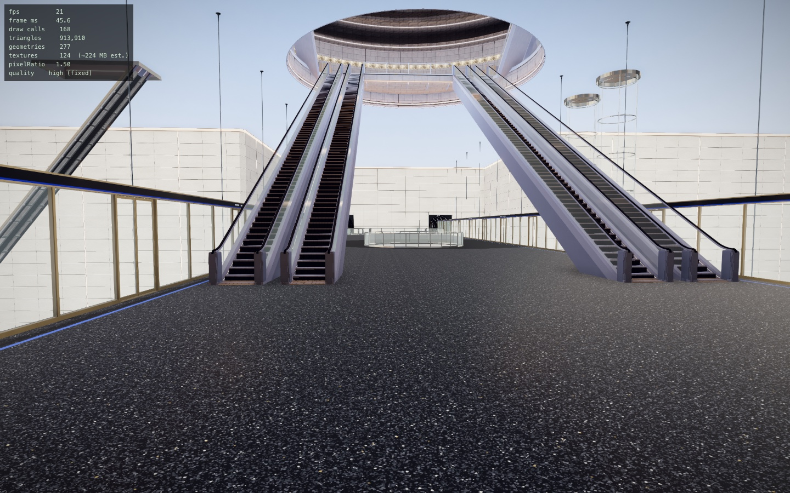

## P4-W — Driverless Mirror Metro Trains Wired Live (`p4-w/`)

Live timetable-driven driverless mirror trains (`seed: 42`, ≤ 4 present across all 6 tracks, 9 calls near / 8 far) wired into `metroDeep` with per-slot cloned PBR/basic materials (`32` PBR + `8` basic sharing the same compiled programs), chained `uTunnel` + per-fragment tunnel-darkness shader (smooth falloff from bore mouth to 120 m inside, fog suppressed inside bores so trains emerge from pure darkness with zero silhouette pop), `renderOrder = 1` clean transparent layering behind PSD glass (`2`) and glass floor (`3`), boot Metal PSO warmup (`warmupVisible` on slot 0), `enteredDeep()` on first deep crossing, `window.__meridian.metro().trains`, both train test suites added to `metro-test` (`72/72`), and the new `train` preset.

- **Train (new preset — Vesper mirror train dwelling with doors open, flush glass nose, warm empty saloon, jade stripe & water wall beyond)** — 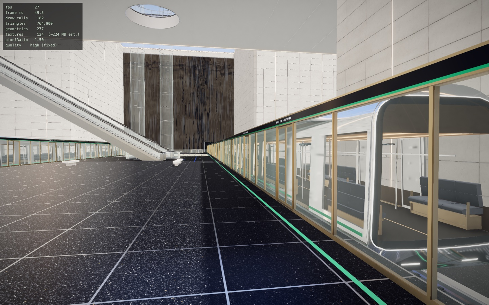
- **Crossing (floating mirror Meridian train gliding 24 m overhead against the buried sky & eclipse — 4 trains live, 189 calls)** — 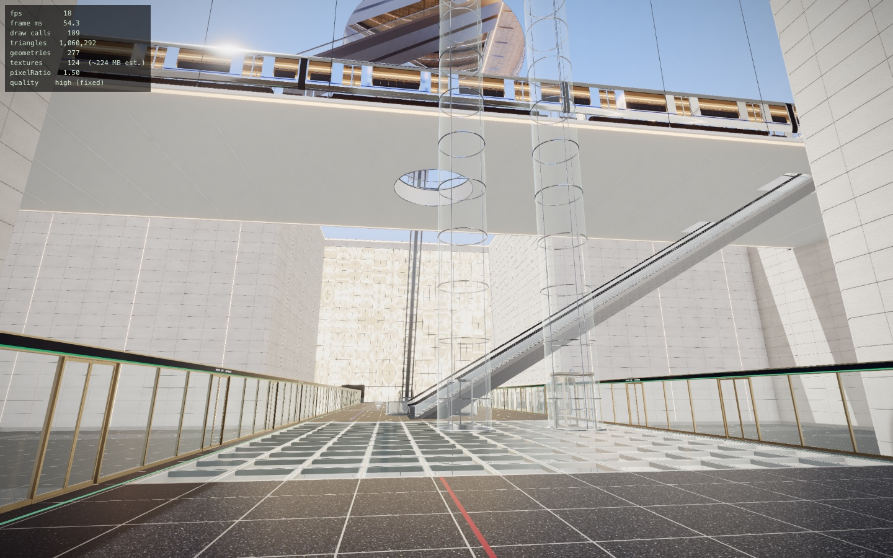
- **Meridian (twin mirror trains flanking the F4 escalators & eclipse — 4 trains live, 190 calls)** — 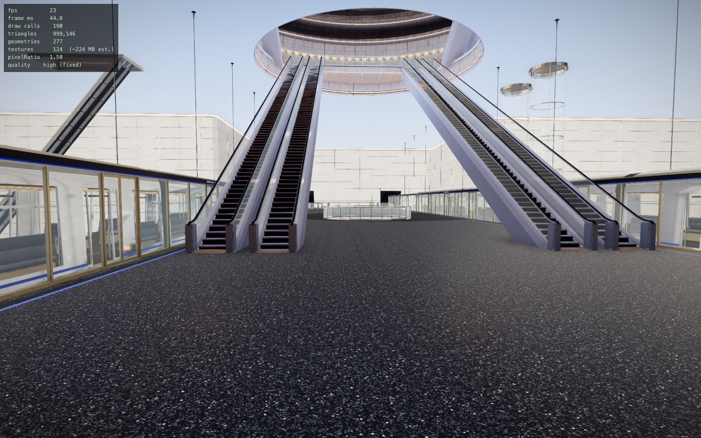
- **Deep (Halcyon oxblood-striped mirror train gliding silently past the low-headroom glass screen — 141 calls)** — 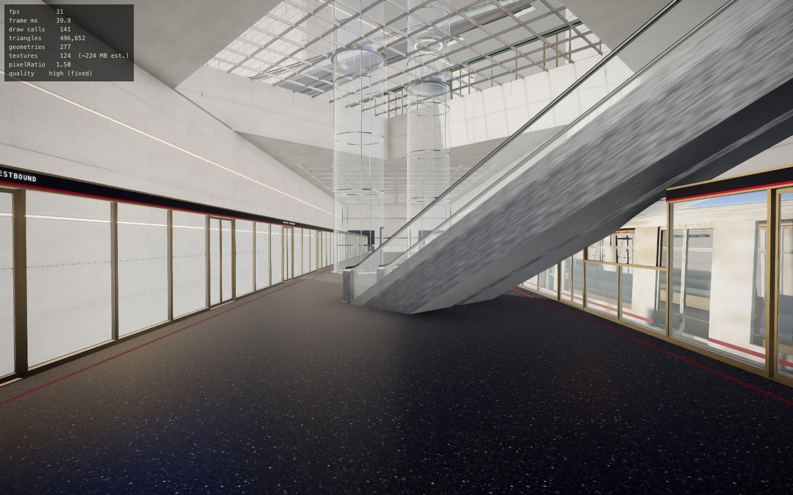
- **Tunnel emergence — 150 m inside bore (pitch black, zero pale fog silhouette)** — 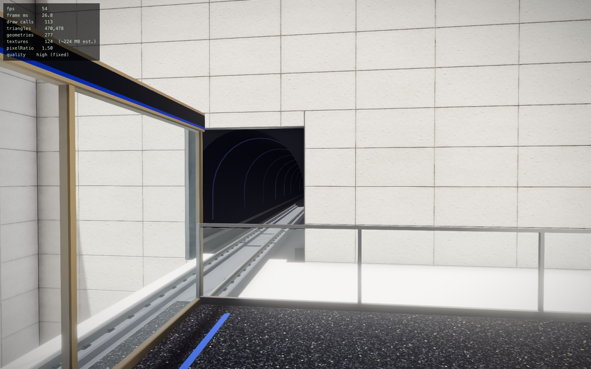
- **Tunnel emergence — 40 m inside bore (soft headlights & edge halo waking up inside the dark horseshoe arch)** — 
- **Tunnel emergence — bore mouth (curved flush glass nose gliding cleanly out of darkness into sunlit cavern reflections)** — 

## P3-9 — Phase 3 Cavern Complete (Sensing Halo, Cleanup & Gate) (`p3-9/`)

Every cavern greybox element is now gone (`greybox.ts` deleted → `impostors.ts`), the subtle warm 3200 K sensing halo is active on deep honed limestone & terrazzo, Metal PSO warmup eliminates the airlock hitch (`177 ms → 24 ms`), and all 20 gate views + extended route test (disc + F6 + lifts + funicular + F5–F1) pass cleanly with the 1910 Grand Hall untouched. Full 20-shot archive is also in [evidence/phase-3/](../evidence/phase-3/README.md).

- **Crossing (finished transept: glass panel, twin lifts, inclined funicular, floating bridge, backlit onyx)** — 
- **Floor (monolith benches, 2035 well gate, inlays, twin lifts & living water wall)** — 
- **Glass-floor look-up (twin sunlit ringed shafts, hovering capsule, floating bridge & buried sun)** — 
- **Sun (buried noon solar disc framed by twin glass shafts & bridge)** — 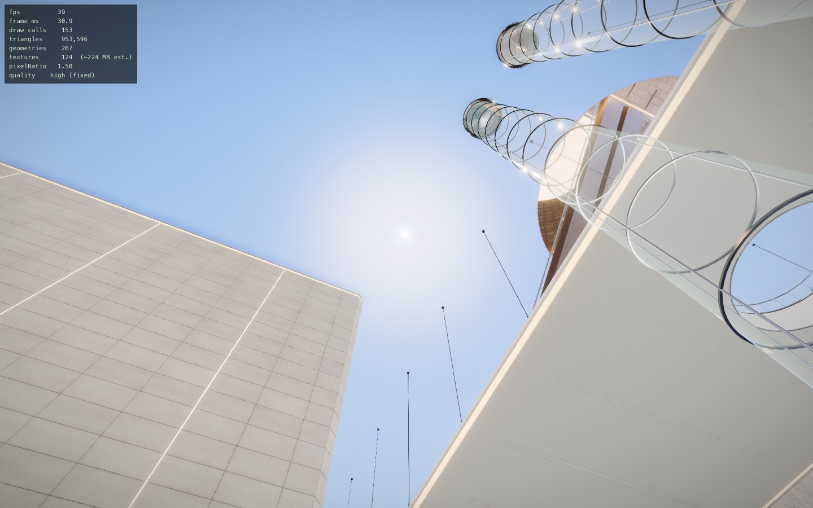
- **Meridian (floating island flanked by funicular monorail & twin glass lifts)** — 
- **Skyride (descending F4 onto Meridian with clean recessed map-wall frieze alcove)** — 
- **Water wall (living liquid black-granite mirror)** — 
- **Onyx wall (backlit book-matched white onyx & funicular monorail)** — 
- **Lift (inside descending capsule with white onyx depth gauge)** — 
- **Twin (empty twin capsule passing)** — 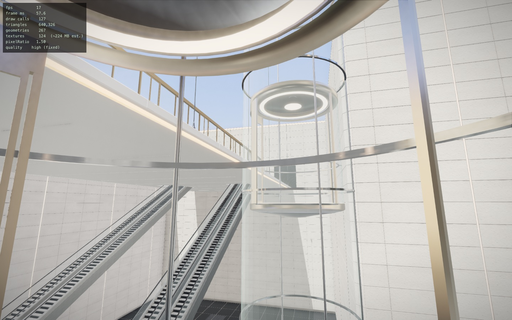
- **Funicular (glass cabin on wedge chassis sliding out of the sky slot)** — 
- **Deep (Halcyon 82 m underground under the daylight shaft)** — 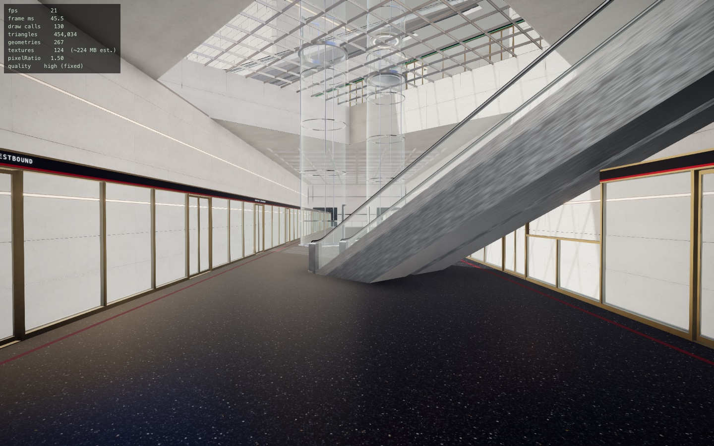
- **Map wall alcove (greybox removed; ready for Phase 4 live map & clock)** — 
- **Balcony (1910 Grand Hall unchanged)** — 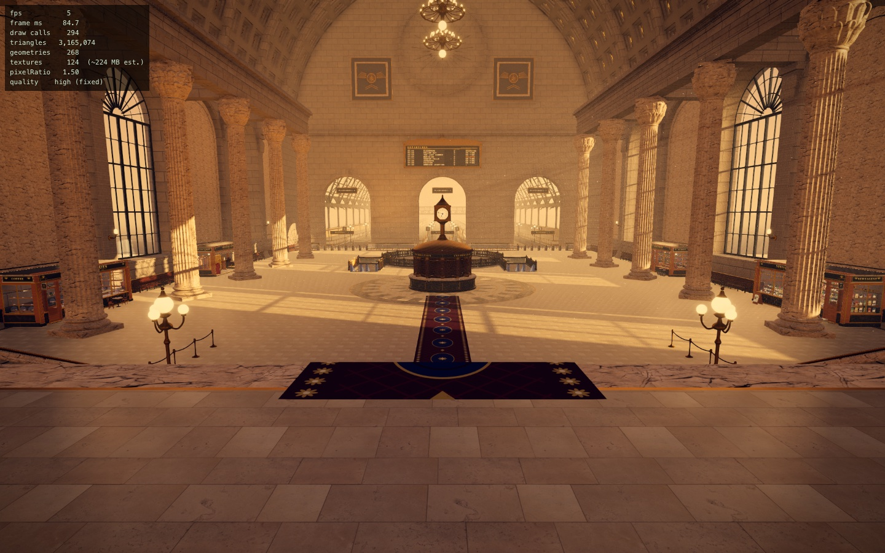

## P3-8b — Inclined Glass Funicular (`p3-8b/`)

Working inclined glass funicular connecting the east Threshold (`−30 m`) top station alcove to the Crossing floor (`−70 m`) east station along a 50.7° brushed-stainless rack rail (Ruling 37):
- **Cabin & chassis (`funicularView.ts`, 4 calls total in `metroVoid` — both-zone env swap):** level 4.0 × 2.4 m champagne-framed glass box with panoramic skylight & warm recessed ceiling halo, dark graphite deck, bi-parting doors on both `±z` long sides (strictly closed while moving), riding on a triangulated brushed-stainless wedge bogie chassis.
- **Rack rail, stations & safety (`funicular.ts`, `funicularView.ts` — 3 deep calls):** brushed-stainless architectural monorail spine + toothed steel rack split cleanly at the sky plane (`y = −32`), enclosed luminous sky-slot light-well hood, top station glass canopy & east Threshold portal (approved Threshold deck untouched), bottom pit (`−76 m`) with hydraulic buffers, under-incline `1.1 m` glass guard protecting `< 2.3 m` headroom (`x ≥ 50.2`), and full-height champagne-framed sliding station gates strictly inside the continuous Crossing east balustrade.

- **Funicular (re-framed hero preset — level glass cabin on triangulated wedge chassis gliding down out of the sky slot toward the camera)** — 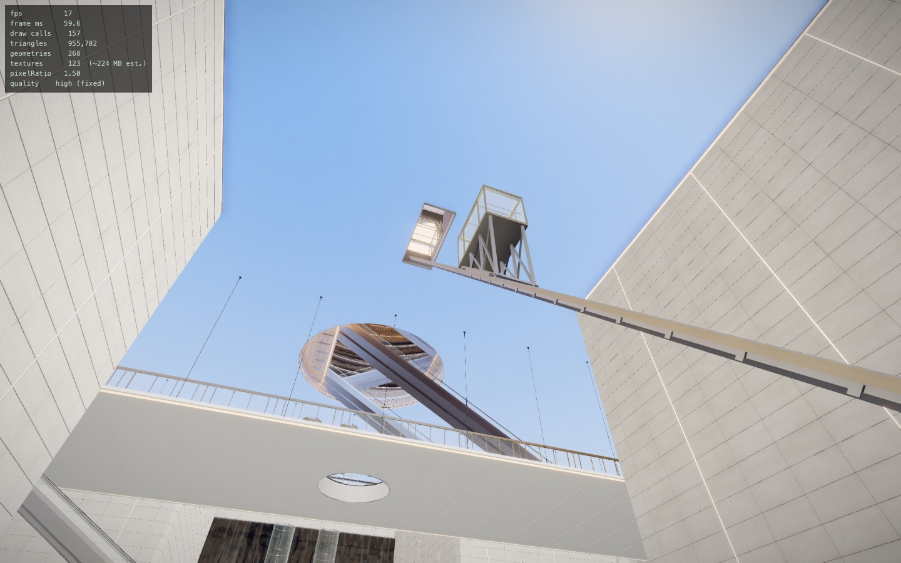
- **Skyhole (enclosed luminous funicular sky slot alongside the circular eclipse & floating Meridian bridge)** — 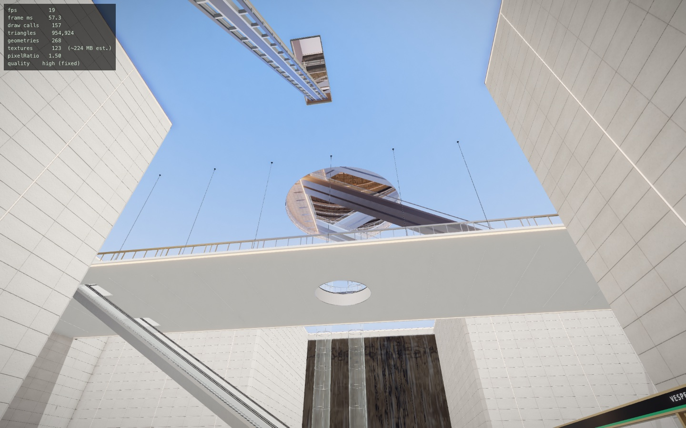
- **Onyx (brushed-stainless monorail spine, under-incline glass guard & bottom station in front of the backlit white onyx wall)** — 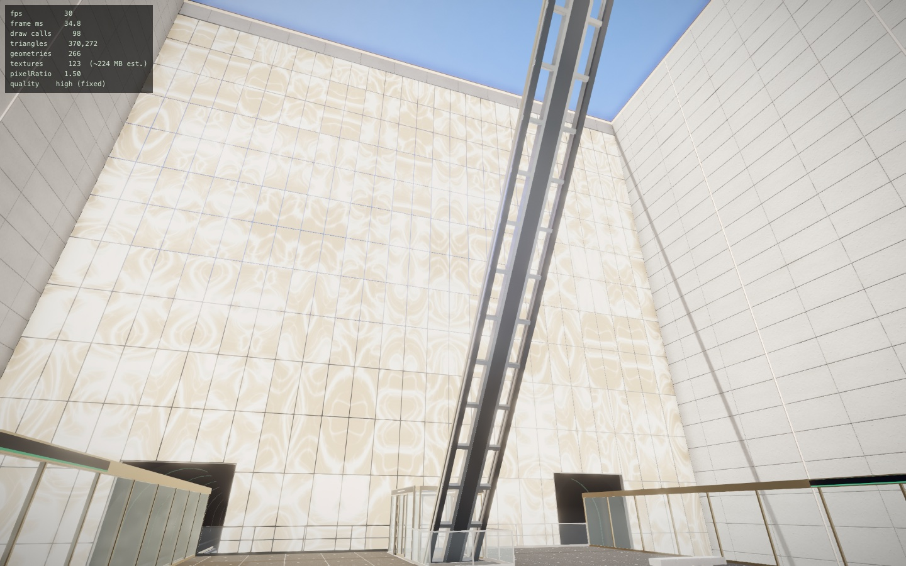
- **Crossing (full transept with twin ringed glass lifts & inclined funicular monorail spine)** — 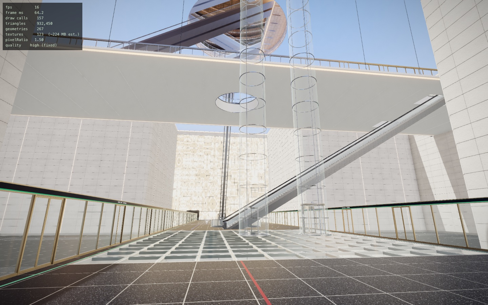
- **Threshold (approved deck & speed gates unchanged; stainless funicular portal visible on east wall)** — 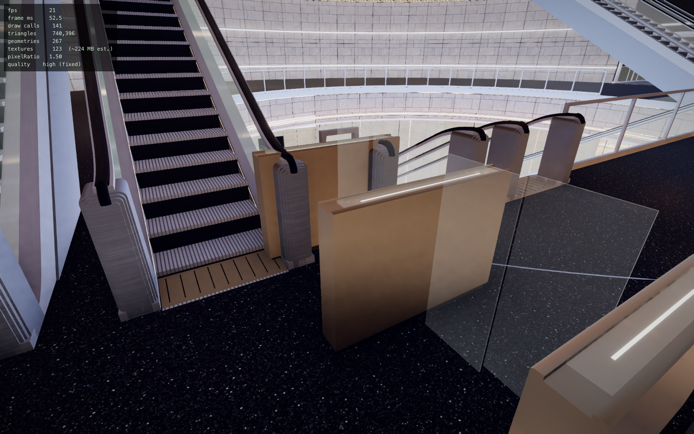

## P3-8a — Twin Glass Capsule Lifts (`p3-8a/`)

Two independent working glass capsule lifts connecting Threshold (`−30 m`), Crossing (`−70 m`), and Halcyon (`−82 m`) both up and down:
- **Cabins (`liftsView.ts`, 6 instanced calls in `metroVoid`, both-zone env swap across the `−16` airlock):** champagne anodised floor/ceiling rings and mullions, brushed-stainless under-bowl and anchored handrail, warm 3200 K ceiling downlight halo + floor micro-cove, bi-parting curved glass doors that rotate smoothly to align with each level's landing, and a backlit **white onyx analog depth gauge (`0 → −82 m`)** with brushed-stainless needle and 3 tactile backlit floor buttons (`−30`, `−70`, `−82`).
- **Tubes & machinery (`liftsView.ts` + `gates.ts`):** ultra-clear deep glass shafts ringed every 3 m in brushed stainless down through the laminated glass floor onto the Halcyon aprons, curved sliding landing doors at all 3 levels, call-button beacons, cut Threshold deck openings with machined stainless sleeves, and rotating sheaves inside the machinery lanterns.
- **Ghost runs & controls (`lifts.ts` + `interaction.ts`):** `E` call buttons outside closed doors and `E` floor buttons inside; seeded deterministic ghost runs every 40–70 s on the unoccupied twin weighted 2:1 toward the player's level.

- **Lift (new preset — inside descending capsule: white onyx depth gauge at `−39.5 m`, backlit buttons, sky hole, Meridian bridge & onyx wall)** — 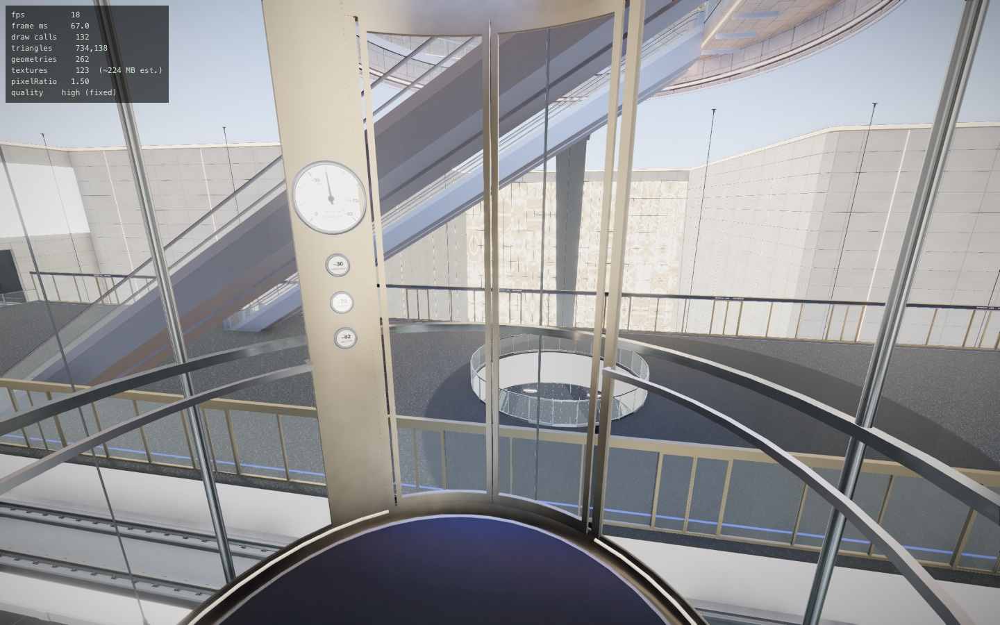
- **Twin (new preset — empty twin capsule gliding past with warm ceiling halo in its ringed glass tube)** — 
- **Lifts (Threshold machinery lanterns with spinning sheaves, docked south capsule, doorway & call buttons)** — 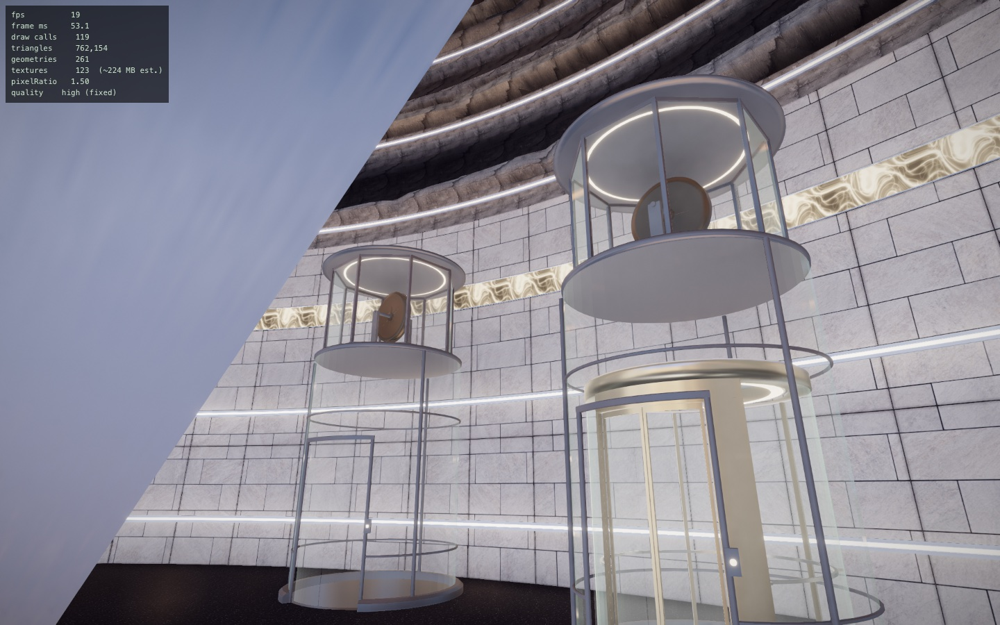
- **Crossing (twin ringed glass lift tubes rising out of the fritted glass floor into the buried blue sky)** — 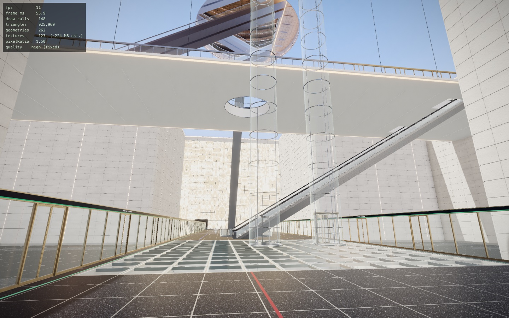
- **Glass floor (ringed glass shafts descending straight onto the Halcyon island landing aprons)** — 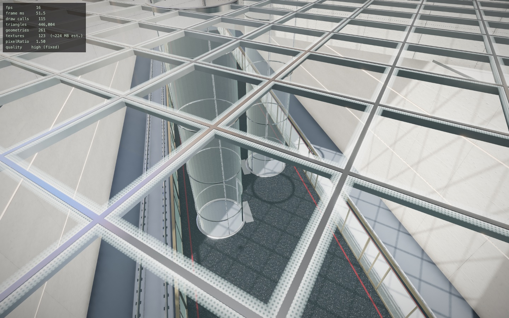
- **Deep (looking up from Halcyon through the skylight at both shafts & the hovering Crossing capsule)** — 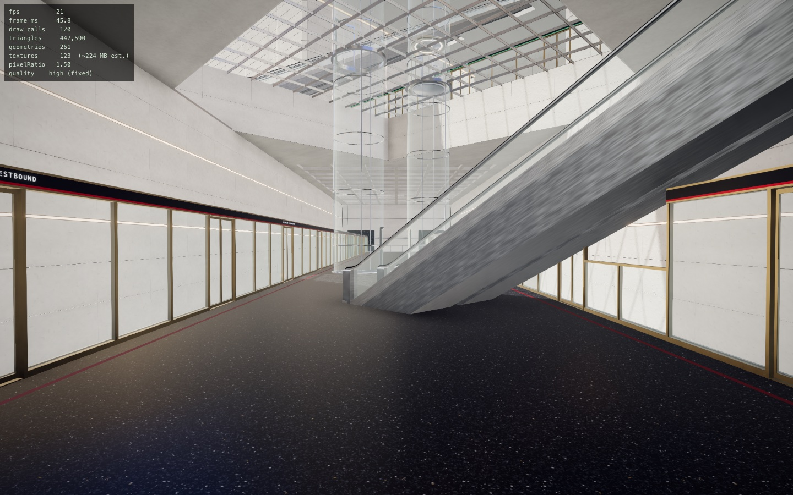

## P3-7 — Living Water Wall & Backlit Book-Matched Onyx Wall (`p3-7/`)

Opposite 40 m × 36+ m feature walls anchoring the transept in 5 draw calls total:
- **West (`waterWall.ts`, 3 calls):** gravity-accelerating laminar water sheet gliding down polished black granite with quintic-smooth animated reflections of the sky, Meridian coves & east onyx wall, top stainless weir lip glint, peaked stainless diverter canopies parting the sheet cleanly around both Vesper west portals with silver edge rivulets, and a calm brushed-stainless catch trough.
- **East (`onyxWall.ts`, 2 calls):** 27 × 13 backlit alabaster-white onyx slabs (`1.48 × 2.96 m`) book-matched symmetrically across slim brushed-stainless mullions, descending into the lit 2 m open floor reveal and pierced cleanly by both Vesper east portals.

- **Water wall (t = 3.0 s — calm liquid curtain reflecting sky, bridge coves & onyx wall)** — 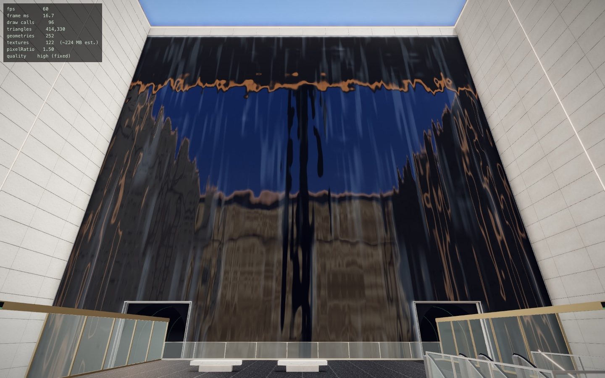
- **Water wall (t = 3.5 s — 0.5 s later confirming living gravity-accelerated motion)** — 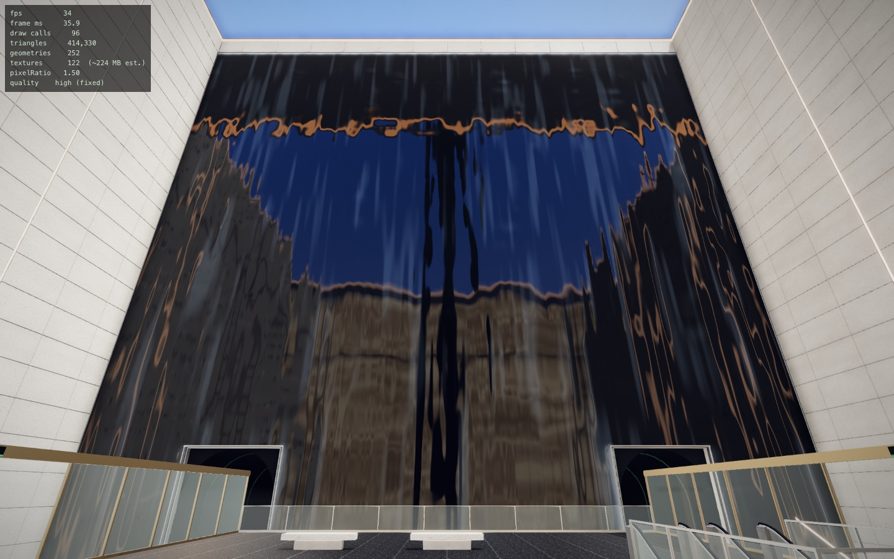
- **Onyx wall (new preset — backlit book-matched alabaster white onyx in stainless grid)** — 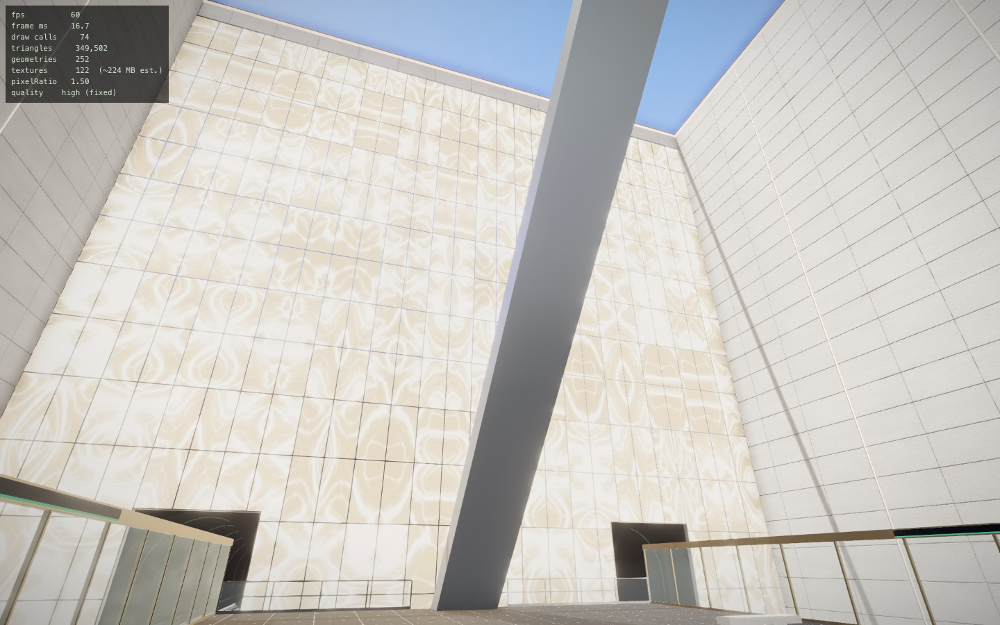
- **Crossing (warm backlit onyx anchoring the east end beneath the floating bridge)** — 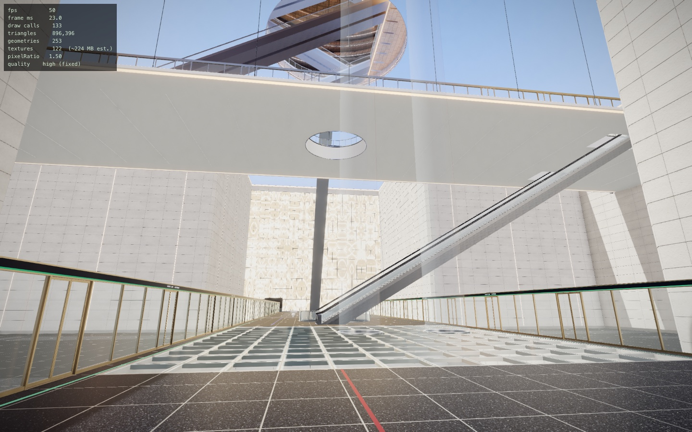
- **Floor (living mirror water wall anchoring the west end)** — 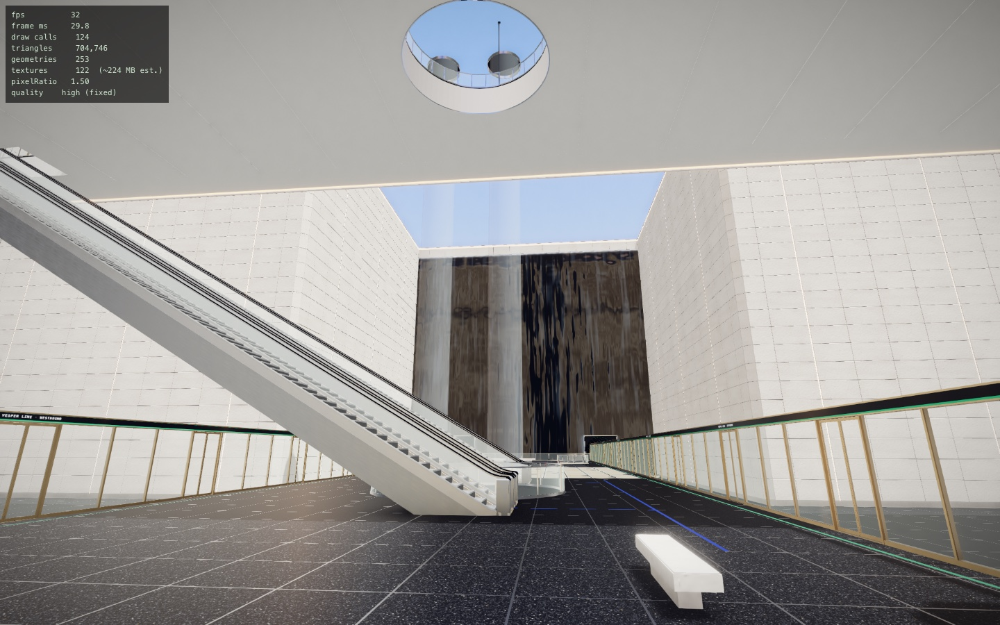

## P3-6 — Twelve Tunnel Bores & Darkened Horseshoe Tunnels (`p3-6/`)

All twelve single-track bores (Meridian north/south, Vesper west/east, Halcyon SW/NE) in 4 draw calls: precision 0.30 m brushed-stainless reveals with 30 mm shadow gaps, 341.5 m (`TIMING.spawnClearance + METRO_TRAIN.length + 10`) horseshoe dark charcoal linings distance-darkened in shader (no fog washout, black end caps), modern slab tracks extending cleanly into the bores, and 684 instanced 6 m arch light-rib fixtures driven by one HalfFloat `DataTexture` (2 % idle shimmer now; arrival waves & departure wakes in Phase 4).

- **Portal (new hero preset — Meridian north arrival bore, slab rails & recessed arch ribs into darkness)** — 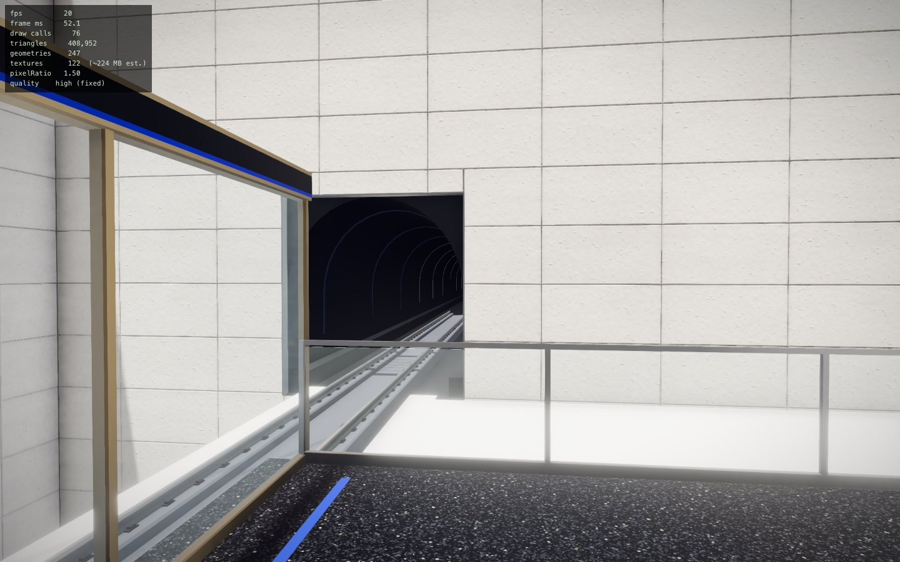
- **Water wall (Vesper west bores piercing polished black granite with crisp stainless reveals)** — 
- **Meridian (north portal pair aligned behind the disc well)** — 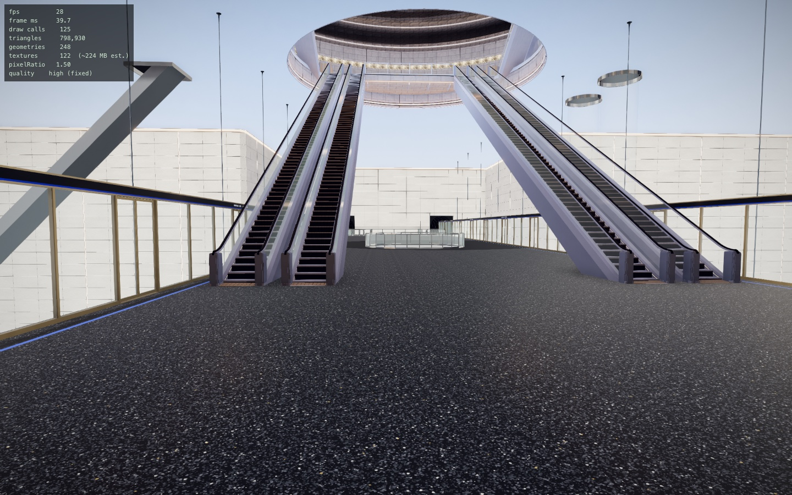
- **Deep (Halcyon NE portal pair terminating the diagonal hall)** — 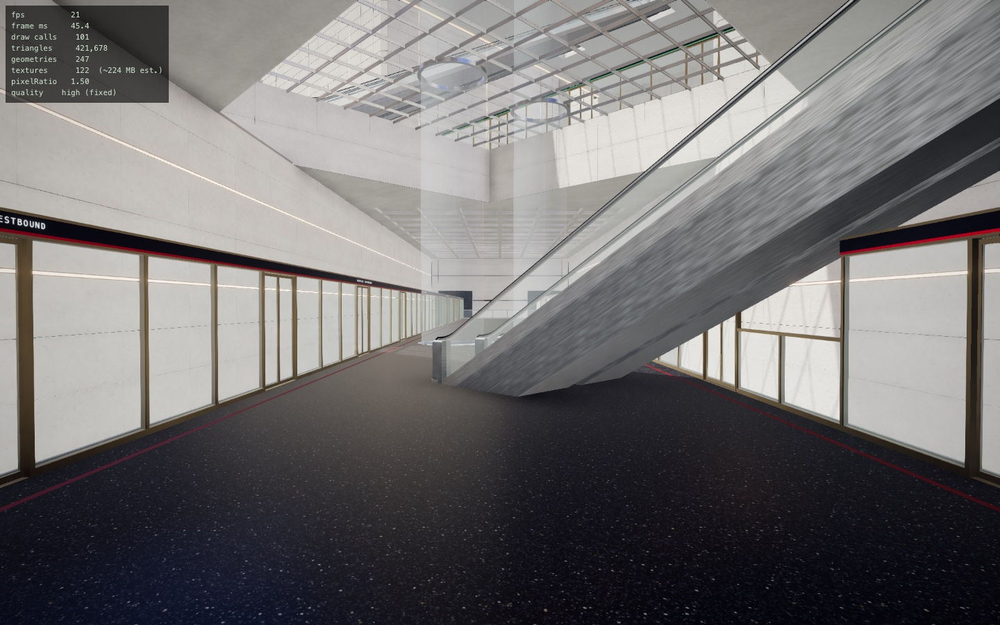

## P3-5 — Halcyon Deep Hall & Daylight Shaft (`p3-5/`)

Enclosed 110 m × 20 m diagonal hall 82 m underground: stack-bond honed limestone walls with two continuous horizontal 4000 K cool light slots (2.4 m & 6.0 m), 3 × 3 m axis-aligned coffered pale ceiling at −73.5 m, rectangular limestone light well rising to the glass floor with two lit diagonal corner light shelves, lined honed-limestone F6 escalator cutting piercing the NW wall (≥ 2.5 m headroom + stainless frame), dark terrazzo island with flush oxblood satin enamel inlays, centre-facing stainless lift landing aprons, Halcyon PSDs (with clean low-headroom step-down under F6), and modern slab tracks — all in 10 draw calls.

- **Deep (82 m underground: daylight shaft through glass floor, coffered ceiling, oxblood PSDs & F6)** — 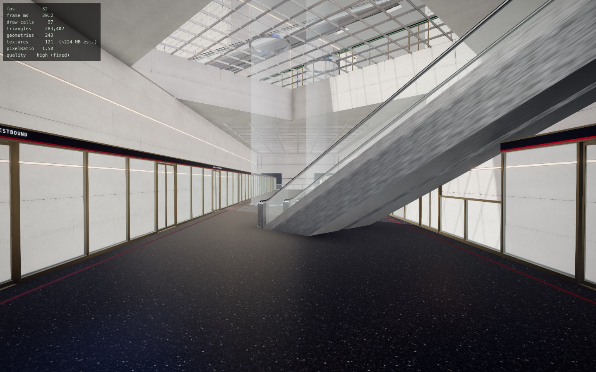
- **Glass-floor look-up (looking 50 m up through T-grid, lift collars, floating bridge & buried sun)** — 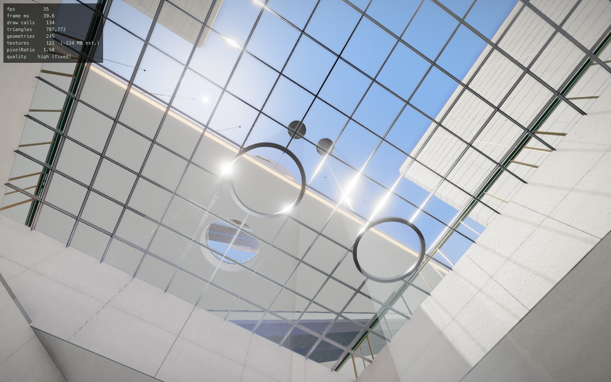
- **Glass floor look-down (lit corner light shelves, sunlit terrazzo island, lift landings & slab tracks)** — 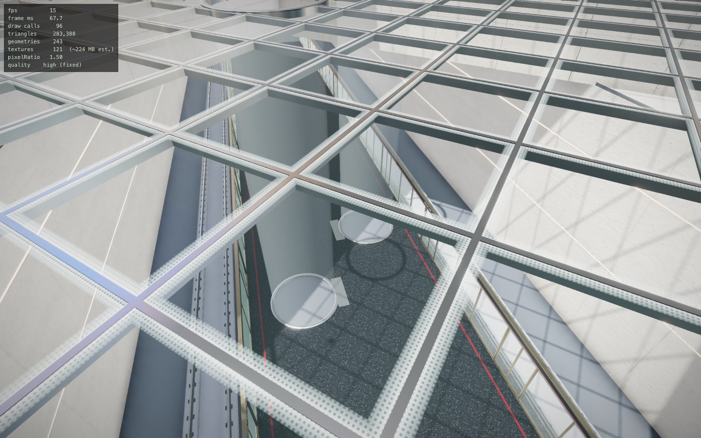
- **Crossing (looking across the walkable glass floor into the finished Halcyon hall below)** — 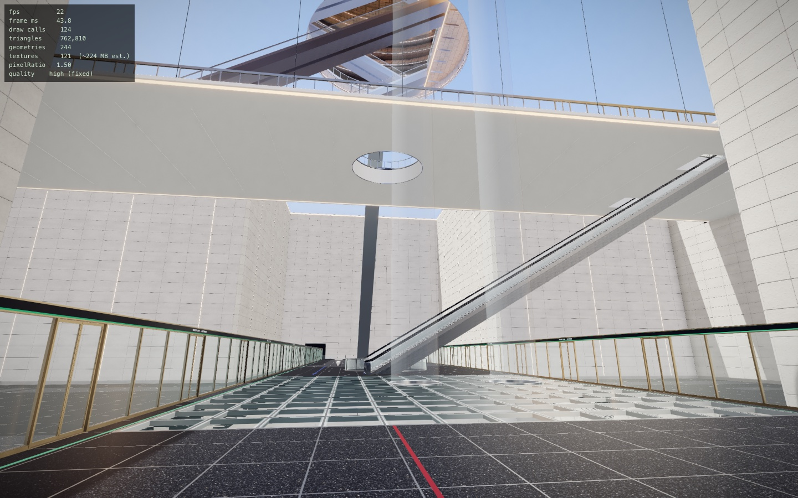

## P3-4 — Crossing Floor, Vesper Tracks, Glass Panel & 2035 Well Gate (`p3-4/`)

116 m × 20 m dark terrazzo Crossing floor with flush 1.5 m brushed-stainless division grid (zero brass in cavern) and flush satin enamel wayfinding inlays (jade along Vesper PSDs, ink-blue from F5, oxblood to F6 & glass panel), full-height Vesper screen doors + fixed end screens, dark Vesper rail trenches with modern slab track and cool edge lights, walkable laminated structural glass floor on a 1.5 m stainless T-grid with 0.10 m ceramic frit borders & lift-tube collars, cantilevered honed-limestone monolith benches with warm 3200 K under-lights, 2035 Monolith circular glass balustrade well ring with curved sliding glass leaves (zero bronze/brass), and bottom newel/combplate height fix across F1–F6.

- **Floor (new preset — benches, well gate, inlays, Vesper PSDs & floating bridge overhead)** — 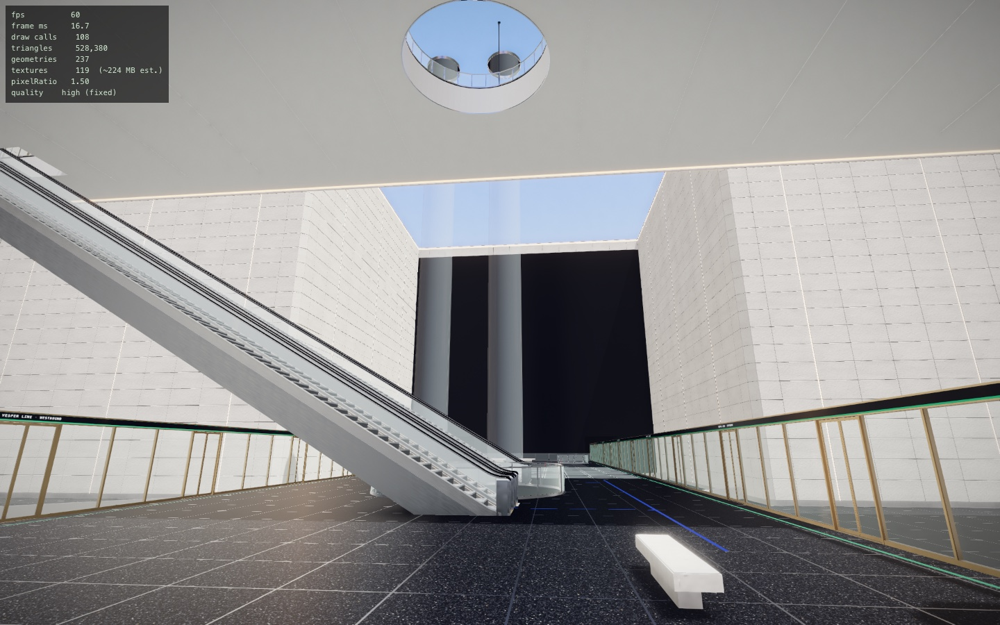
- **Well gate (2035 curved sliding glass ring replacing 1910 bronze gate + flush F5 combplates)** — 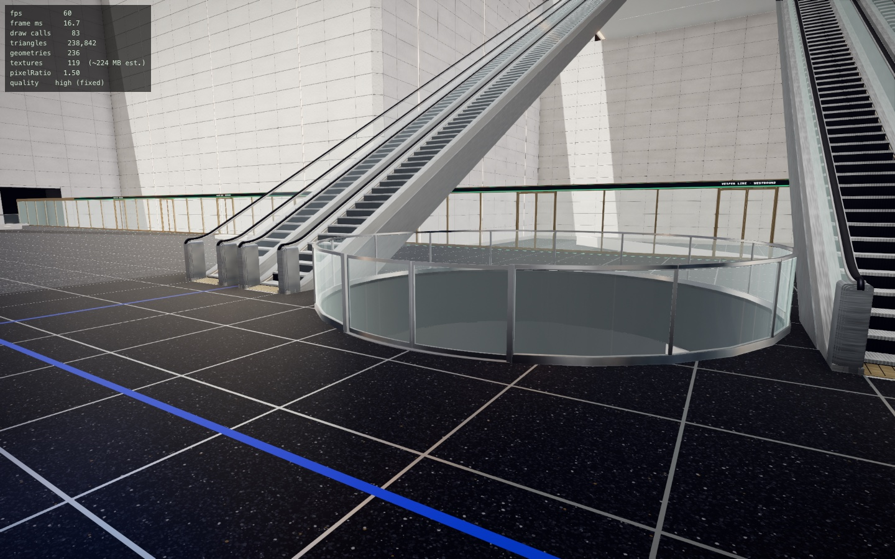
- **Glass floor (laminated structural panes, 0.10 m ceramic frit borders, stainless T-grid, view to Halcyon)** — 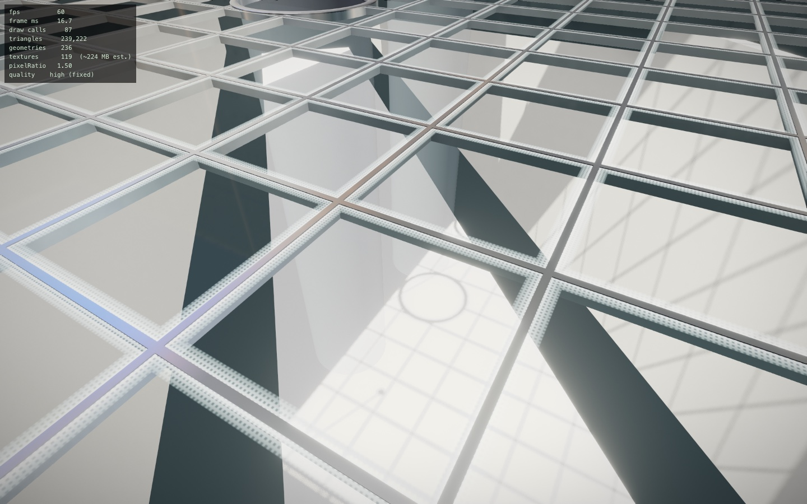
- **Crossing (full transept, glass panel, oxblood/jade inlays, floating Meridian bridge)** — 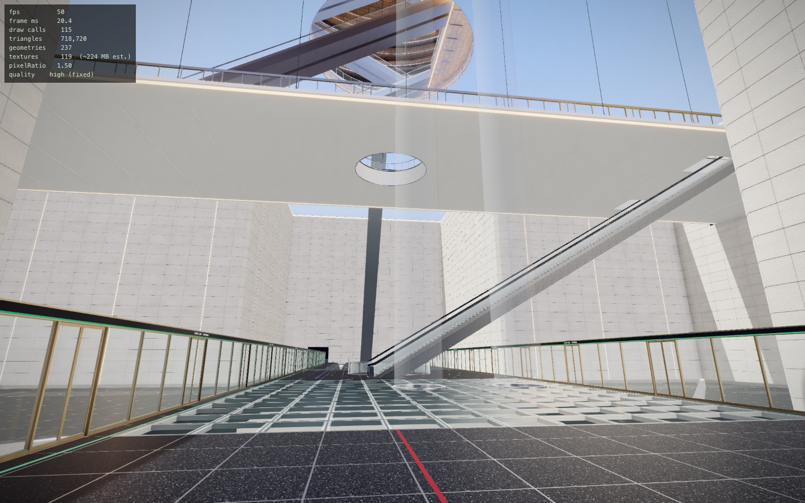
- **Meridian (cleaned up — F4 bottom newels/combplates flush, phantom F5 piers removed)** — 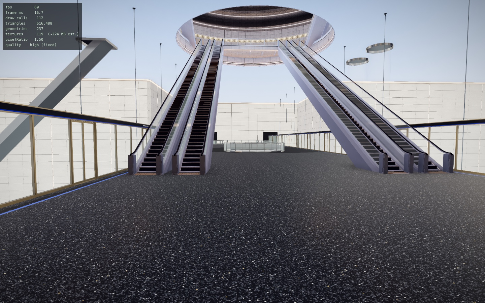
- **Funicular view (bridge coves + hangers + sky)** — 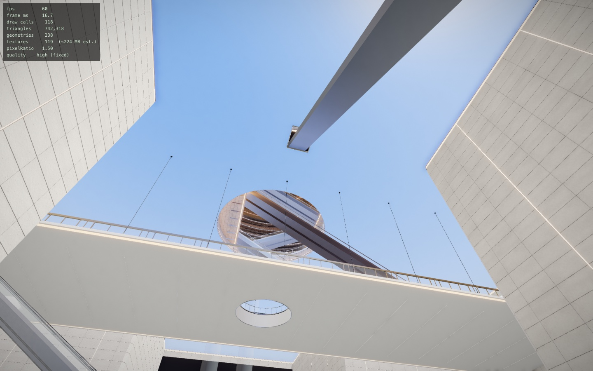
- **Water wall bay (Vesper west bores + black granite backing)** — 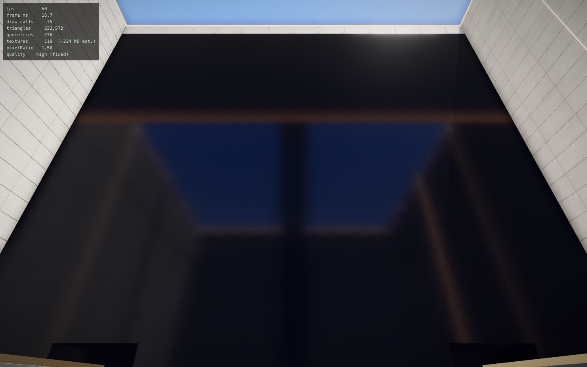

## P3-3 — Floating Meridian Bridge, Platform Screen Doors & Slab Track (`p3-3/`)

Chamfered white-steel box-girder bridge spanning the 108 m nave with 50 mm wall expansion gaps, warm 3200 K soffit coves along both outer edges, 6 m fascia splices & underside ribs, 22 hairline stainless tension hangers anchored flush into the buried sky, dark polished terrazzo island with flush ink-blue satin enamel inlays, ultra-clear 1.1 m glass balustrades, reusable champagne-framed full-height screen doors (`psd.ts`, white dot-matrix transoms + non-emissive line bar), and modern concrete slab tracks (`track.ts`).

- **Crossing (bridge floating on hangers + warm 3200 K edge coves)** — 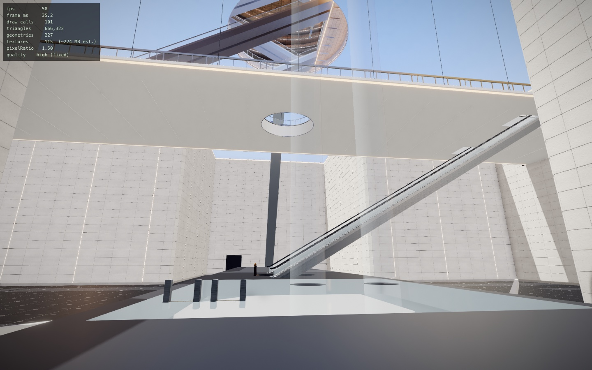
- **Skyhole (underside cove ribbons + disc-well collar + sky rosettes)** — 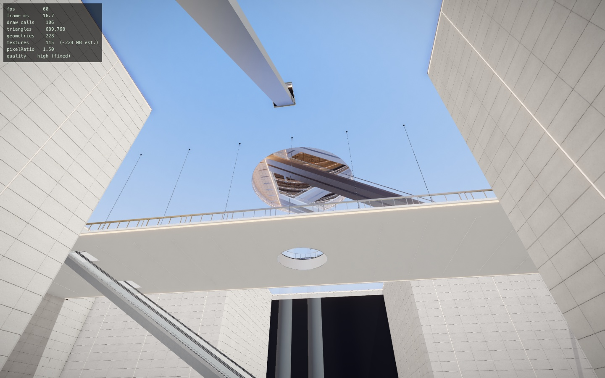
- **Meridian (terrazzo deck, ink-blue inlay, champagne PSDs, F4 landing)** — 
- **Skyride (descending F4 onto the bridge, slab tracks entering twin bores)** — 
- **Mapwall (under F4 looking south down the platform)** — 

## P3-2 — The Buried Sky (`p3-2/`)

CoeLux-style "window to infinity" noon sky 32 m underground, razor-crisp SSE solar disc + tight aureole, polished stainless slot collars around lift tubes and funicular, sealed eclipse aperture lip, eclipse + slot shadow casters (`3.08 × 3.07 cm/texel` cross-prism shadow fit), and new/re-framed `sun`, `skyride`, and `skyhole` presets.

- **Sun (buried noon sky & solar disc)** — 
- **Skyhole (re-framed eclipse unobstructed above bridge)** — 
- **Skyride (descending F4 out of the sky hole)** — 
- **Glass-floor look-up (sun & sky from 82 m deep)** — 
- **Crossing (deep noon blue overhead)** — 
- **Funicular view (chamfer corners sealed flush)** — 
- **Meridian (eclipse shadow on bridge + composed north end wall)** — 

## P3-1 — Monolith Cavern Shell & Base Floor (`p3-1/`)

Honed pale limestone panels on a 3.0 m × 1.525 m stack-bond grid, chamfered re-entrant corners, glowing 12 m vertical light slots, floating sky reveal, west polished black granite wall, and dark terrazzo base floor with flush brushed-stainless 3 m strips.

- **Crossing** — 
- **Meridian** — 
- **Water Wall (black granite base + Vesper bores)** — 
- **Funicular view (chamfered corners + light slots)** — 
- **Map Wall recess + Meridian south bores** — 
- **Deep (Halcyon view up)** — 
- **Skyhole (pre-reframe)** — 

## P3-0 — DepthLook Verification & Hall Reference (`p3-0/`)

- **Balcony (hall unchanged)** — 
- **Concourse** — 
- **Oculus** — 
- **Sinking Floor disc** — 
- **Void strata** — 
- **Crossing (pre-shell baseline after deep env fix)** — 
