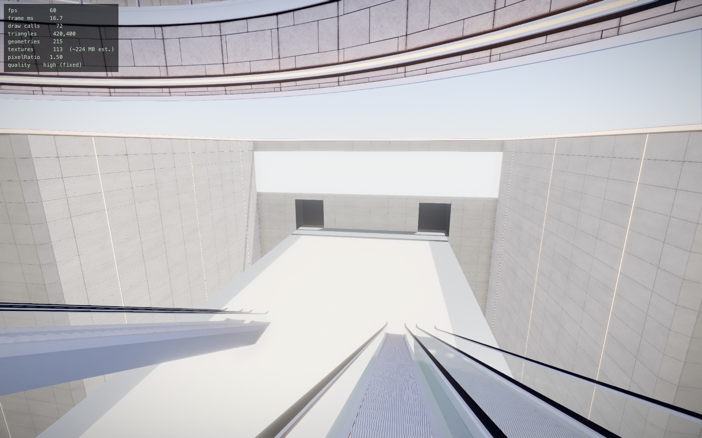
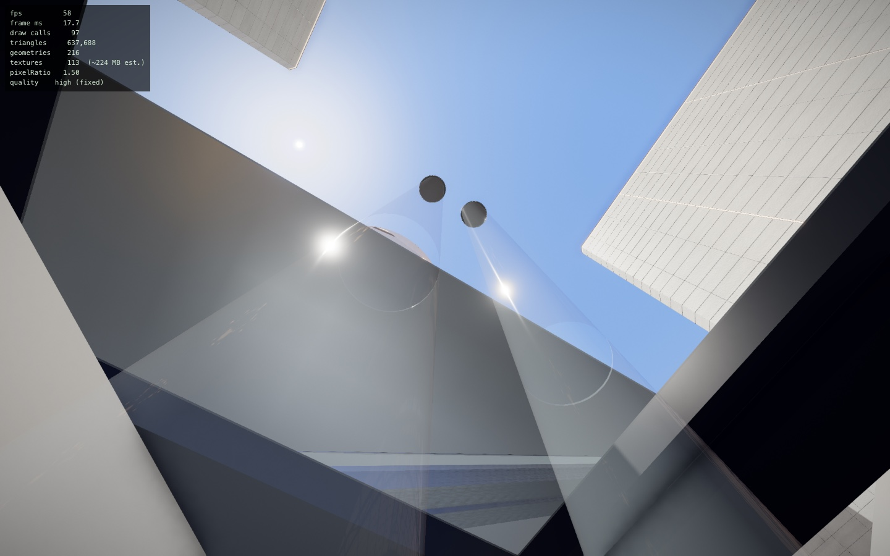
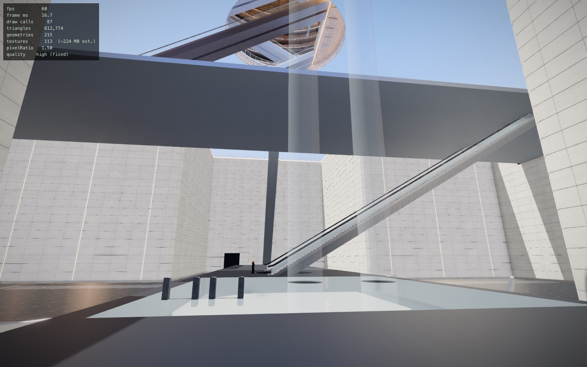
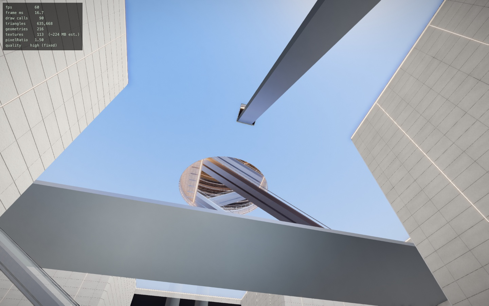
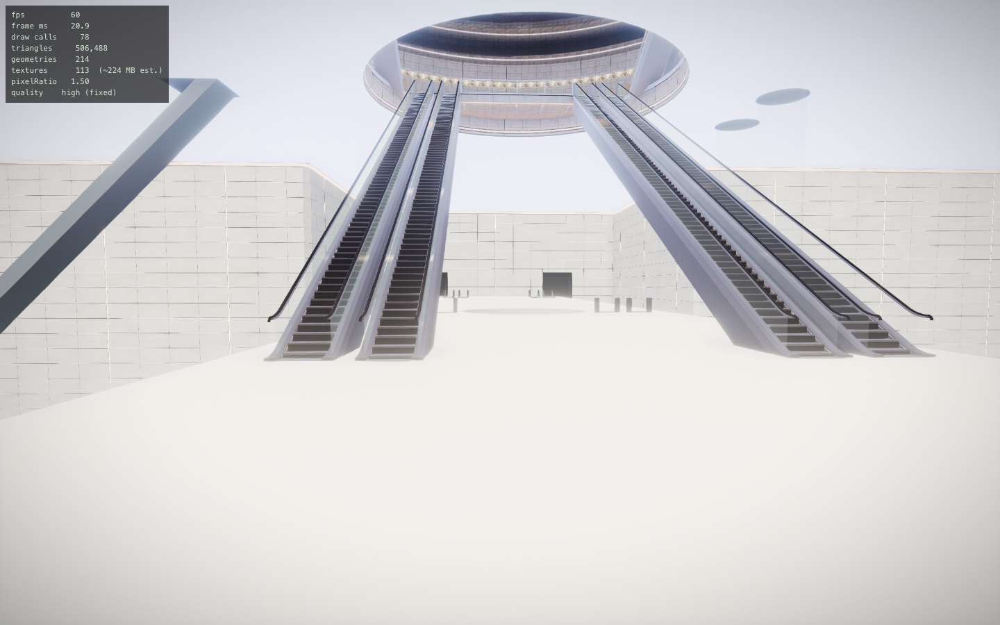
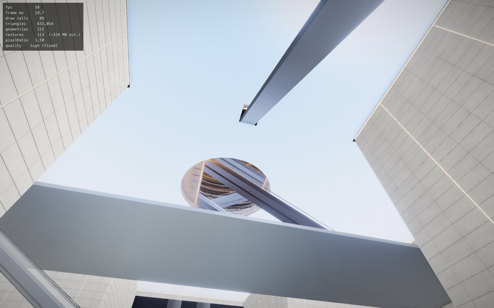
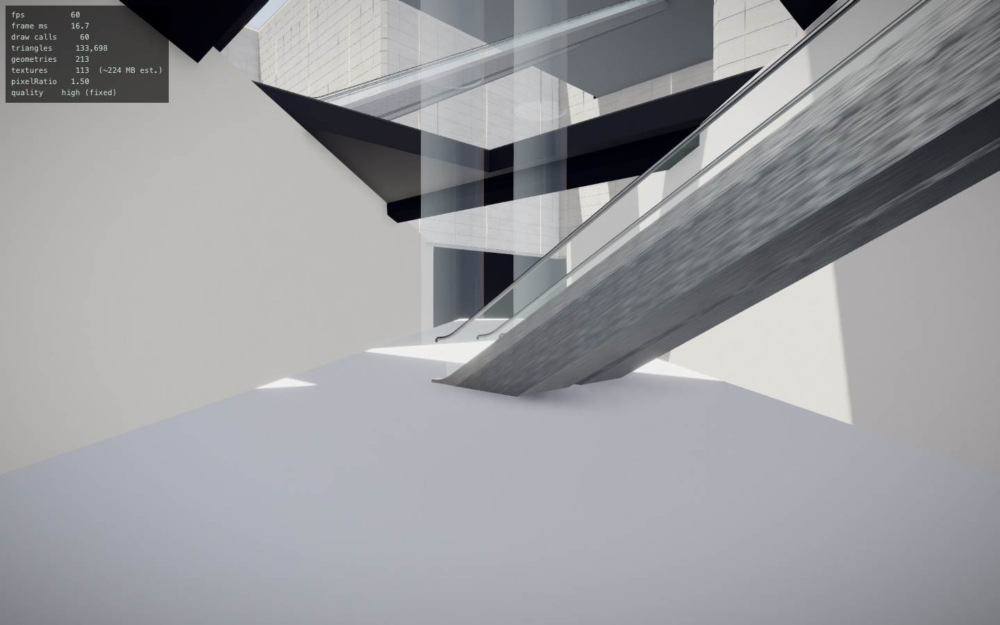

# Meridian Deep — Build Previews (Phases 3–5)

Updated after each completed task so you can browse every new screenshot in one place.

## P3-2 — The Buried Sky (`p3-2/`)

CoeLux-style "window to infinity" noon sky 32 m underground, razor-crisp SSE solar disc + tight aureole, polished stainless slot collars around lift tubes and funicular, sealed eclipse aperture lip, eclipse + slot shadow casters (`3.08 × 3.07 cm/texel` cross-prism shadow fit), and new/re-framed `sun`, `skyride`, and `skyhole` presets.

- **Sun (buried noon sky & solar disc)** — 
- **Skyhole (re-framed eclipse unobstructed above bridge)** — 
- **Skyride (descending F4 out of the sky hole)** — 
- **Glass-floor look-up (sun & sky from 82 m deep)** — 
- **Crossing (deep noon blue overhead)** — 
- **Funicular view (chamfer corners sealed flush)** — 
- **Meridian (eclipse shadow on bridge + composed north end wall)** — 

## P3-1 — Monolith Cavern Shell & Base Floor (`p3-1/`)

Honed pale limestone panels on a 3.0 m × 1.525 m stack-bond grid, chamfered re-entrant corners, glowing 12 m vertical light slots, floating sky reveal, west polished black granite wall, and dark terrazzo base floor with flush brushed-stainless 3 m strips.

- **Crossing** — 
- **Meridian** — 
- **Water Wall (black granite base + Vesper bores)** — 
- **Funicular view (chamfered corners + light slots)** — 
- **Map Wall recess + Meridian south bores** — 
- **Deep (Halcyon view up)** — 
- **Skyhole (pre-reframe)** — 

## P3-0 — DepthLook Verification & Hall Reference (`p3-0/`)

- **Balcony (hall unchanged)** — 
- **Concourse** — 
- **Oculus** — 
- **Sinking Floor disc** — 
- **Void strata** — 
- **Crossing (pre-shell baseline after deep env fix)** — 
